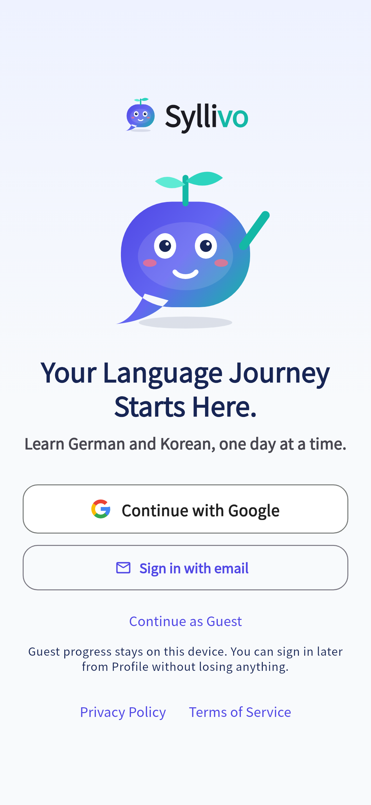
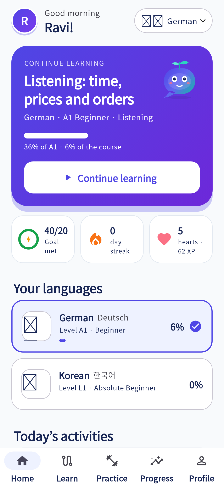
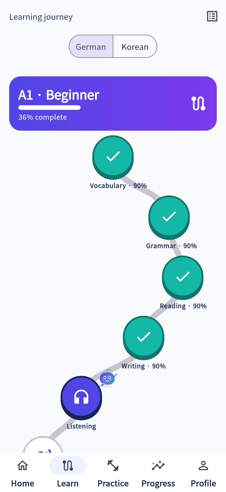
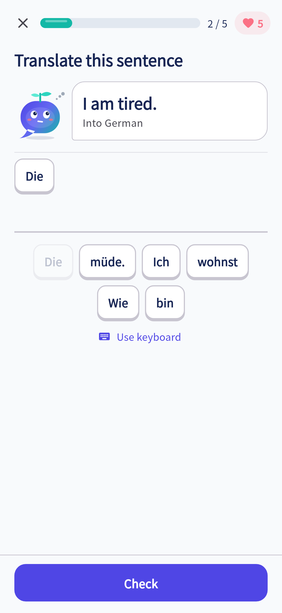
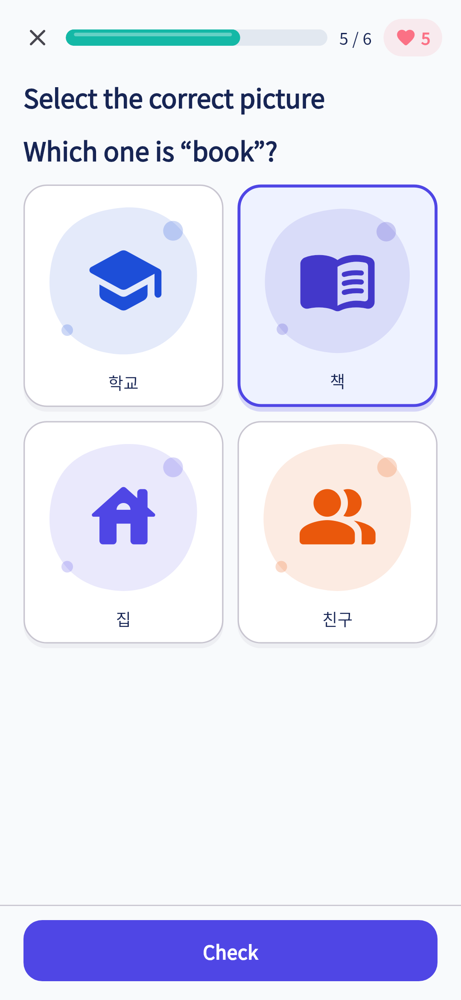
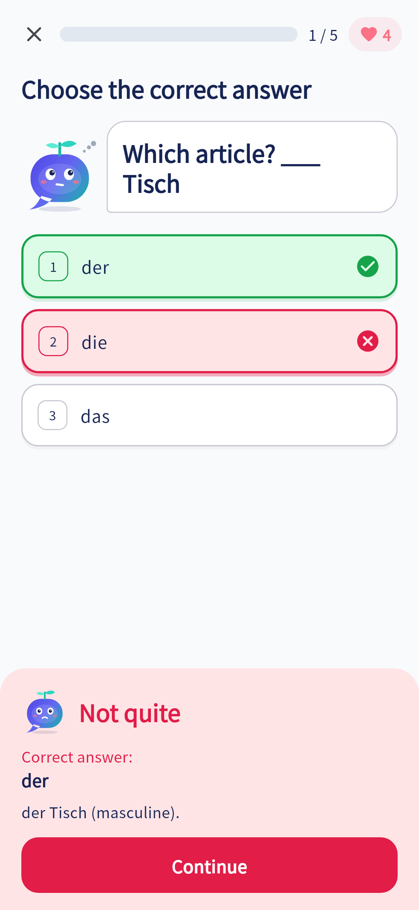
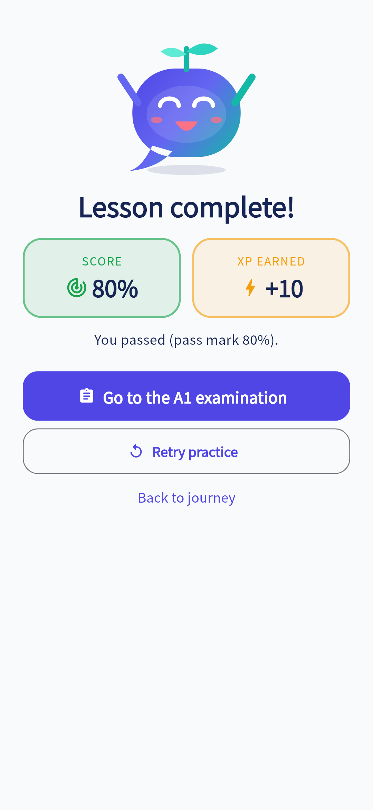
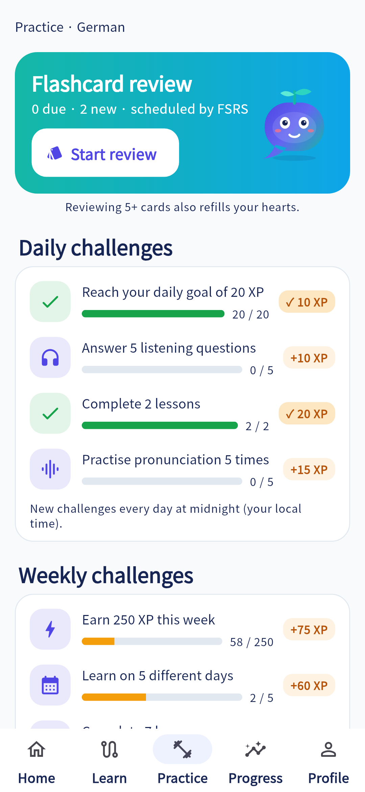
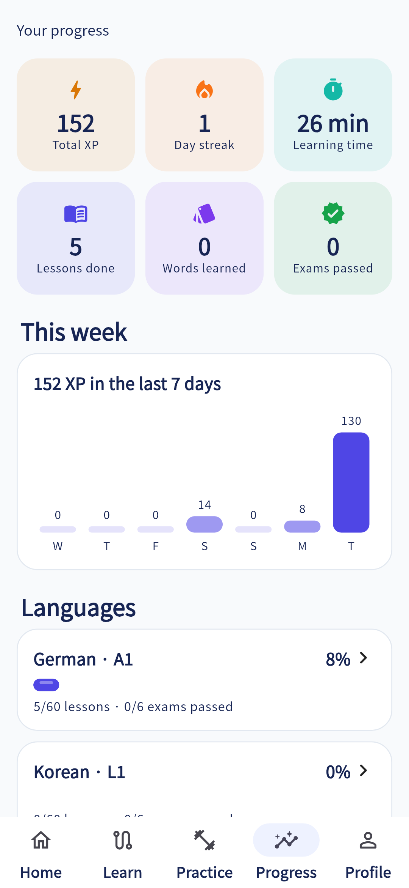

# Syllivo

**Learn Languages. Unlock Opportunities.**

[](https://github.com/YOUR_USERNAME/Syllivo/actions/workflows/ci.yml)


Syllivo is an offline-first, gamified German and Korean learning app. It combines short guided lessons, an original companion called **Sylli**, XP, streaks, missions and badges with a structured curriculum: German A1 – C2 and Korean Levels 1 – 6. It evolved from the Lingo app. Every earlier feature is preserved, including the curriculum, exams, placement test, FSRS flashcards, pronunciation scoring, statistics and database migrations.

<p align="center">
  
  
  
  
  
</p>
<p align="center">
  
  
  
  
</p>

*Screenshots are rendered from the real app by `tool/screenshots/screenshot_test.dart`.*

## Features

### Brand and design system
- **Original identity:** the Syllivo wordmark, and **Sylli**, a speech-bubble companion with a sprout. Sylli is drawn in code (no image assets), has five moods, and is also the app icon.
- **Design system** in `lib/app/theme.dart`: navy `#172554`, indigo `#4F46E5`, lavender `#EEF2FF`, teal `#14B8A6`, coral `#FB7185`. It defines rounded cards, consistent radii, subtle shadows, and light and dark themes.
- **Lightweight animations:** press-scale buttons, animated progress bars and rings, a sliding feedback panel, a pulsing microphone, confetti on completion, and haptic feedback.
- **Accessibility:** all animations respect the system *Remove animations* setting.

### Splash and onboarding
The splash screen shows the logo, Sylli, the tagline and a loading bar. Onboarding then takes five steps:

1. **Welcome**, with an optional name.
2. **Language:** German or Korean.
3. **Current level**, or *I'm not sure*.
4. **Daily XP goal:** 10, 20, 30 or 50.
5. **Start:** take the placement test, or start as a beginner (or at the chosen level).
6. **Welcome to your course:** shows the first course for that language and level (for example *At home & describing things · German · A1 Beginner · Vocabulary*) with **Continue learning**.

**Placement test:** each language uses only its own questions, three per level, with a progress bar, level and question counter, Sylli beside each question, and feedback after each answer. **Submit answer** stays disabled until you answer. The test stops at the first level where fewer than two of three answers are correct. If you close the app mid-test, you can resume at the same question. The result screen shows the recommended level, your score per level, **Start at X**, and **Start from A1/L1 instead**. The result is saved, and the placement screen offers it again so you don't have to repeat the test.

You can change everything later in Profile or Settings, or run onboarding again.

### Five tabs
| Tab | What's there |
|---|---|
| **Home** | Avatar and greeting; streak, XP and hearts; daily-goal ring; active course with **Continue learning** (resumes the last unfinished lesson); German and Korean progress side by side; today's activities; daily challenges; flashcard reviews; badges |
| **Learn** | A visual **learning journey**. Each level is a winding path of its 10 module nodes plus an exam node, marked completed, current, available or locked, with level completion %. The existing unlock rules apply. |
| **Practice** | FSRS flashcard review, the **daily challenges** area, **weekly challenges**, speaking drills, word decks and the placement test |
| **Progress** | Totals (XP, streak, learning time, lessons, words, exams), a 7-day XP chart, per-language progress, per-skill performance for German and Korean, exam history, and all badges with **unlock history** |
| **Profile** | Avatar, name, active language, daily goal, hearts on/off, starting level, and **Settings** (review algorithm, pass mark, romanization, theme) |

### Interactive lessons
Lessons open full screen.

- **Top bar:** close button (progress is saved), animated progress bar, question counter and hearts.
- **Middle:** Sylli presents each question in a speech bubble.
- **Bottom:** a sticky **Check** button. After checking, a feedback panel slides up: green for correct with praise, red with the correct answer and an explanation.

| Exercise | Implementation |
|---|---|
| Translation | **Word tiles** built from the answer plus distractors drawn from the lesson; a keyboard is also available |
| Multiple choice | Numbered option cards with immediate correct/incorrect marking |
| **Picture vocabulary** | 4 illustrated choices; tapping one speaks the word (new question type, 9 questions so far) |
| Listening | Large play button plus slow playback |
| Speaking / pronunciation | Microphone with a recording animation, using the existing recognizer and scorer, with per-syllable highlighting |
| Word ordering | Tap tiles to build the sentence |
| Grammar | Explanations and tables, then fill-in-the-blank and correction with explanations |
| Reading | Passages with comprehension questions, beginner through advanced |
| Writing | The existing checker (length + target words) with a model answer |
| Matching | Colour-paired columns |

All exercises use the real curriculum and the existing grading code.

### Gamification
- **XP** for each activity:

  | Activity | XP |
  |---|---|
  | Lesson passed | 10 (+5 if perfect) |
  | Lesson attempted | 3 |
  | Exam passed | 50 |
  | Level completed (first time only) | 100 |
  | Flashcard reviewed | 1 |
  | Placement test | 15 |
  | Badge earned | 25 |

- **Streaks**, using the existing streak logic.
- **Daily goal**, with a progress ring on Home.
- **Daily missions:** the daily goal plus three drawn by date from a pool. The pool includes learning 10 new words, reviewing 15 cards, a grammar lesson, 5 listening questions, practising pronunciation 5 times, and 2 lessons.
- **Weekly challenges:**
  - earn 250 XP
  - learn on 5 different days
  - complete 7 lessons
  - review 75 cards
- **Automatic rewards.** Missions and challenges are measured from real activity and award XP once per local day or week. Every claim is kept as history.
- **16 badges** covering milestones, including vocabulary mastery at 25, 100 and 250 words. Each is stored with its unlock date.
- **Hearts:** 5, minus one per mistake in lessons. They regenerate one every 30 minutes, or refill completely after reviewing 5+ flashcards. You can switch them off.
- **Celebrations** with Sylli and confetti on lesson and level completion.

## Sign-in (Google, email, guest) — setup

Version 4.0 adds a login screen with **Continue with Google**, **Sign in with email** and **Continue as Guest**. It uses Firebase Authentication and `google_sign_in`. The app never stores passwords or Google tokens; the Firebase and Google SDKs manage them in secure platform storage. The app keeps only the UID, name, email, photo URL and account creation date in its local database.

Until Firebase is configured, the app builds and runs normally. The Google and email buttons show a clear "not set up in this build" message, and guest mode works fully. To enable sign-in:

1. Create a project at <https://console.firebase.google.com>.
2. Add an **Android app** with package name `com.lingo.lingo_app`.
3. Add your SHA-1 fingerprints, both debug and release: `cd android && ./gradlew signingReport`.
4. Go to **Authentication → Sign-in method** and enable **Google** and **Email/Password**.
5. Download `google-services.json` into `android/app/`. The Gradle build applies the Google services plugin automatically when that file exists. Then rebuild with `flutter build apk --release`.

**Guest → account:** signing in from the login screen or Profile links the existing on-device progress to the account. XP, streaks, lessons and history are never reset. **Sign out** keeps progress on the device. **Delete account** removes the Firebase account, and erases local progress only if you tick the box.

## Architecture

The existing stack is unchanged: Flutter, Riverpod, GoRouter (now with a `StatefulShellRoute` for the tabs), Drift/SQLite, flutter_tts, speech_to_text, and FSRS/SM-2. No new runtime dependencies were added.

```
lib/
  app/            theme.dart (design system), shell.dart (bottom nav), app.dart (router)
  core/widgets/   companion.dart (Sylli), illustrations.dart, syllivo_widgets.dart
  features/
    onboarding/   splash + onboarding
    home/ journey/ practice/ stats/ profile/      the five tabs
    gamification/ game.dart (rules), game_providers.dart (state + GameService), game_widgets.dart
    curriculum/   lesson player, exam, placement, question widgets (redesigned)
    flashcards/ lessons/ pronunciation/ progress/ settings/   existing features
```

**Database v4** adds four tables: `xp_events`, `mission_claims`, `badge_unlocks` and `game_state` (hearts). It only creates tables, and the migration from v1 to v4 is tested. Learning preferences are stored in SharedPreferences.

**Picture questions** are appended to the end of existing lessons, so saved resume positions stay valid, and the affected levels' content versions were bumped.

## Build and run
```bash
flutter pub get
dart run build_runner build --delete-conflicting-outputs
dart format .
flutter analyze
flutter test
flutter build apk --release --split-per-abi
```

Regenerating assets is optional:
- `python3 tool/curriculum/build.py` regenerates the curriculum JSON.
- `flutter test tool/brand/icon_test.dart --update-goldens` regenerates the app icon.
- `flutter test tool/screenshots/screenshot_test.dart --update-goldens` regenerates the screenshots.

## Tests
`flutter test` runs 106 tests:
- **Gamification:** day and week keys, mission selection, one-time claims and claim history, XP totals that exclude rewards, mission measurements from real activity, the weekly chart, heart loss, regeneration and refill, badges with unlock dates, XP for lessons and exams, one-time level XP, profile preferences.
- **Syllivo flows:** splash → onboarding → personalised Korean dashboard; every tab; journey nodes and locked levels; a lesson that spends a heart and awards XP; running out of hearts; translation with word tiles; picture questions with speech; **app restart resuming the unfinished lesson**; exam XP appearing on Progress.
- **Everything from before:** curriculum and JSON validation, grading, unlocking, placement, migrations, progress persistence, speech errors, flashcards, FSRS/SM-2, achievements and settings.

## Honest limitations
- **Sign-in needs your Firebase project** (see above). It is not pre-configured in the shipped APK.
- **No cloud sync:** progress lives on the device. An account identifies you, but it does not yet sync progress between phones. That would need Firestore and a backend.
- **No reminder notifications:** there is no notification package, so there are no notification toggles. The app has no non-functional switches.
- **iOS:** this project currently has only an Android platform folder. Run `flutter create --platforms ios .` and set `CFBundleDisplayName` to *Syllivo* to add iOS.
- **No sound effects:** feedback uses haptics and animation only, to avoid adding an audio dependency.
- **Picture questions** exist in 7 lessons (9 questions). Other lessons use the exercise types their content supports; not every lesson contains every exercise type.
- **Content depth** is unchanged from 2.0: one lesson per module per level.
- **Speech scores** depend on the device's recognizer and are a practice guide, not an assessment. The exams are practice, not official CEFR or TOPIK results.
